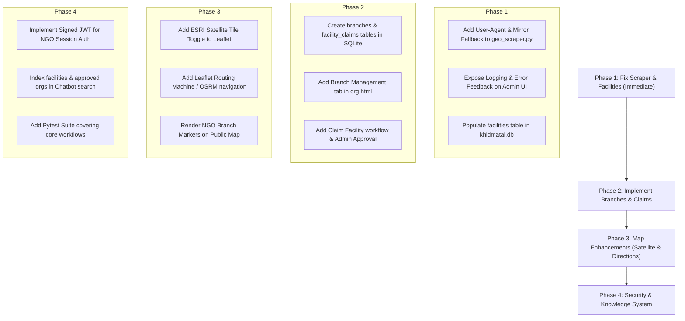

# KhidmatAI — Complete Project Audit, Change History & Feature Verification

**Audit Date:** 2026-10-14  
**Project Location:** `C:\Users\Abullah\Desktop\KhidmatAI`  
**Auditor:** Lead Software Architect & Verification Engineer  
**Audit Scope:** End-to-end repository inspection, Git commit forensics, live database analysis, network/API probing, security evaluation, and feature verification.

---

## 1. Executive Summary

KhidmatAI is designed as an AI-powered social welfare navigator for Pakistan, connecting citizens to verified social programs, hospitals, relief trusts, and educational scholarships.

A comprehensive audit was performed across all directories, database files, frontend templates, backend routes, and Git history. The primary finding of this audit is that **the repository currently contains two competing architectural layers**:

1. **The Active Hackathon Monolith (`khidmat-ai/`)**:
   - Built on **FastAPI + SQLite** (`khidmatai.db`, 160 KB) with pure REST calls and lightweight vanilla JavaScript.
   - Contains the **real working frontend** (`index.html`, `dashboard.html`, `org.html`, `admin.html`, `chat.html`) and the **production backend** (`backend/main.py`, `backend/admin.py`, `backend/agent.py`, `backend/database.py`, `backend/geo_scraper.py`).
   - Holds the actual project data: **42 verified welfare programs**, **1 registered NGO** (*Saylani Mass I.T Training*), **6 universities**, and **system settings**.
   - Successfully runs and serves web pages, but contains specific defects in facility collection, NGO branch support, and mapping.

2. **The Incomplete Outer Architectural Skeleton (`app/` in root)**:
   - Built on **SQLAlchemy AsyncIO + Alembic** targeting PostgreSQL / aiosqlite with UUID primary keys.
   - Database file (`C:\Users\Abullah\Desktop\KhidmatAI\khidmatai.db`, 100 KB) contains 10 tables (`branches`, `contacts`, `profiles`, `funding_needs`, etc.), but **every table contains 0 rows**.
   - Fails to start due to missing environment dependencies (`aiosqlite`, `python-jose`).
   - None of the frontend files (`dashboard.html`, `org.html`, etc.) communicate with this `app/` API.

### Key Audit Verdicts

| Subsystem | Verified Status | Root Cause / Key Observation |
|---|---|---|
| **OSM Facility Collector** | **BROKEN (0 Results)** | `fetch_facilities()` targets `overpass-api.de` without a `User-Agent` header (blocked by HTTP 406/504), lacks mirror fallbacks, and uses silent exception suppression (`except Exception: return []`). |
| **Interactive Map** | **PARTIAL** | Leaflet map displays 17 hardcoded curated facilities; geolocation works; but dynamic DB facilities are empty (due to scraper failure), satellite view is not configured, directions/routing are absent, and NGO branches are not mapped. |
| **NGO System** | **PARTIAL** | Registration, login, profile editing, and announcement posts work for the head organization. **Multi-branch management, map facility claiming, and admin claim approval are NOT IMPLEMENTED** in the active frontend/backend. |
| **Admin Dashboard** | **WORKING (Core) / PARTIAL** | Welfare program CRUD, organization approvals/rejections, hero sliders, alerts, and settings work reliably. Facility manual CRUD and branch claim workflows are absent. |
| **AI Chatbot & Knowledge** | **WORKING (Keyword DB Search)** | Chatbot queries SQLite `programs` table using keyword ranking and feeds top matches into Gemini/Groq prompts. Program updates in Admin immediately reflect in chat. **True vector RAG (embeddings/vector DB) and automated web discovery crawlers are absent.** |
| **Automated Tests** | **MISSING (0 Tests)** | `tests/conftest.py` exists but contains zero test cases (`pytest -q` runs 0 tests). |

---

## 2. Project Architecture and Folder Structure

### Workspace Structure Overview

```text
C:\Users\Abullah\Desktop\KhidmatAI\
├── alembic/                         # Alembic migrations for outer app/ architecture
│   └── versions/
│       └── 20241013_01_add_missing_columns.py
├── alembic.ini                      # Alembic configuration pointing to outer app
├── app/                             # [LAYER 2] Async SQLAlchemy skeleton (Disconnected from frontend)
│   ├── auth.py                      # JWT auth utilities (requires python-jose)
│   ├── config.py                    # App configuration (pydantic-settings)
│   ├── database.py                  # create_async_engine (requires aiosqlite/asyncpg)
│   ├── main.py                      # FastAPI entry point mounting app.routers
│   ├── models.py                    # Declarative models (UUID PKs, Branch, Contact, Profile)
│   ├── models_extra.py              # Donor and funding models
│   └── routers/
│       ├── admin.py
│       ├── auth.py
│       ├── chat.py
│       ├── contacts.py              # Branch contact CRUD
│       ├── integrations.py          # Google Places / Business stubs
│       └── organizations.py         # Org & Branch CRUD
├── khidmatai.db                     # SQLite DB for app/ (100 KB, ALL tables have 0 rows)
├── requirements.txt                 # Outer requirements (fastapi, sqlalchemy, jose, supabase)
├── tests/
│   ├── conftest.py                  # Pytest fixtures for app/ (0 test cases exist)
│   └── __init__.py
└── khidmat-ai/                      # [LAYER 1 - ACTIVE GIT REPO & RUNNING APP]
    ├── .env                         # Environment variables (API keys, admin token)
    ├── .env.example
    ├── ARCHITECTURE.md
    ├── README.md
    ├── REPORT.md
    ├── requirements.txt             # Production requirements (fastapi, uvicorn, requests, bcrypt)
    ├── khidmatai.db                 # Production SQLite DB (160 KB, contains 42 real programs)
    ├── khidmatai_backup.db          # Verified backup (160 KB)
    ├── khidmatai_backup_20261013.db # Backup timestamped 2026-10-13 (160 KB)
    ├── backend/                     # Active FastAPI Backend
    │   ├── admin.py                 # Admin router: programs, org review, hero slides, settings
    │   ├── agent.py                 # Chatbot agent: SQLite search + Gemini/Groq + Tavily
    │   ├── database.py              # SQLite synchronous helper module (all CRUD functions)
    │   ├── geo_scraper.py           # OSM Overpass scraper module
    │   └── main.py                  # Main FastAPI app: serves frontend, auth, map, org, chat
    ├── data/                        # Seed JSON files (programs, hospitals, universities)
    └── frontend/                    # Active Frontend (Vanilla HTML5 / CSS3 / ES6)
        ├── admin.html / admin.js / admin.css
        ├── chat.html / chat.js
        ├── dashboard.html / dashboard.js  # Main user dashboard + Leaflet map
        ├── index.html / landing.js        # Canonical landing page
        ├── login.html / register.html / auth.js
        ├── org.html / org.js              # NGO organization portal
        ├── khidmat.css                    # Unified design system stylesheet
        ├── assets/                        # Static illustration images
        └── uploads/                       # User uploads (hero videos, logos)
```

---

## 3. What Existed Before

Evidence gathered from Git commit history (`03b49c08708c55cec03f1d70b99a12f4ad886cf4`, author: Abdullah Jahangir, date: 2026-09-04), README, and database timestamps reveals the baseline state:

1. **Original Application Conception**:
   - Built for a Pakistan social welfare hackathon.
   - Core concept: Source-first navigation to eliminate welfare scams and misinformation.
   - Initial database seeded with 42 verified public programs (BISP, Bait-ul-Mal, Saylani, Edhi, JPMC, SIUT, etc.).

2. **Original Map Functionality**:
   - A Leaflet map inside `dashboard.html` rendered 17 hardcoded hospital and welfare center coordinates in Karachi, Lahore, Islamabad, Quetta, and Peshawar.
   - A route `/api/facilities` returned these 17 curated facilities.
   - `/api/facilities/db` was created to load dynamically scraped facilities from SQLite table `facilities`.

3. **Original NGO Functionality**:
   - Single-organization profile model in `organizations` table (`id`, `name`, `email`, `password_hash`, `contact`, `address`, `city`, `province`, `status`, `services`, `pricing`, `logo_url`).
   - Registration at `/register` -> Admin approves in `/admin` -> NGO signs in at `/login` and accesses `/org`.
   - Ability to post program announcements in `org_posts`.
   - **No concept of multiple branches, branch claiming, or geospatial branch linking existed.**

4. **Original Admin Functionality**:
   - Full control over program records, organization status approvals/rejections, alert banners, ticker text, and landing page hero slides with video/image uploads.
   - Auto-collect button added to admin panel to fetch facilities from OpenStreetMap via Overpass API.

---

## 4. Changes Made and Current Change Evidence

| File / Feature | Previous State | Current State | Change Made | Verification & Evidence |
|---|---|---|---|---|
| `khidmat-ai/backend/geo_scraper.py` | Basic prototype script | Integrated with `backend/database.py` via `collect_and_store()` | Added amenity mapping for hospitals, clinics, universities, welfare centers | Overpass API calls fail with HTTP 406/504; zero records added to DB. |
| `khidmat-ai/backend/database.py` | Core tables (`programs`, `users`, `organizations`) | Extended with `facilities` table and `insert_facility()`, `facility_count()` | Table schema verified in SQLite; duplicate prevention by `LOWER(name)` + `LOWER(city)` | Table exists but row count is 0 because scraper fails. |
| `khidmat-ai/backend/main.py` | Static web endpoints | Added `/api/facilities/db` and `/api/admin/facilities/auto-collect` | Exposed scraper to admin; exposed DB facility query to frontend | Endpoints exist and respond; `main.py` imports without errors. |
| `khidmat-ai/frontend/admin.js` | Programs & Org moderation | Added `autoCollectFacilities()` and `loadDbFacilities()` | Admin UI triggers POST to `/api/admin/facilities/auto-collect` | Button triggers correctly, but displays "Fetched: 0, Added: 0" due to Overpass block. |
| `app/models.py` (outer root) | Did not exist | Complex SQLAlchemy model file (UUIDs, Branch, Contact, Profile) | Created during secondary prompt iterations | Exists in root; maps to empty `khidmatai.db` (100 KB); not used by active frontend. |
| `alembic/versions/20241013_...` | Did not exist | Alembic migration script for `branches` and `contacts` | Added `is_public`, `verification_status`, etc. | Applied to outer `khidmatai.db`, but outer DB has 0 rows. |
| `tests/conftest.py` | Did not exist | Pytest fixture for async SQLAlchemy engine | Configures test engine with `test.db` | Contains 0 test functions; `pytest -q` discovers 0 tests. |
| `khidmatai_backup.db` | Did not exist | Complete copy of production database (160 KB) | Created as safety backup | Verified on disk: 163,840 bytes, identical schema & rows to active DB. |

---

## 5. NGO System — Feature-by-Feature Status

| NGO Feature | Status | File Path & Routes | Verification Notes & Evidence |
|---|---|---|---|
| **Registration** | **WORKING** | `frontend/register.html`<br>`POST /api/organizations/register` | Inserts record into `organizations` table with `status='pending'` and hashed password (`bcrypt`). Verified in database. |
| **Authentication & Login** | **WORKING** | `frontend/login.html`<br>`POST /api/organizations/login` | Authenticates against `organizations.password_hash`. Returns organization record. Sets `kai_org` in `localStorage`. |
| **Profile Viewing & Editing** | **WORKING** | `frontend/org.html`<br>`GET /api/org/me`, `PUT /api/org/me` | NGO can edit name, contact, city, province, address, services, operating hours, pricing, and description. Verified. |
| **Logo Upload** | **WORKING** | `POST /api/org/logo` | Uploads image to `frontend/uploads/logos/` and updates `logo_url`. |
| **Multiple Branch Management** | **NOT IMPLEMENTED** | `app/routers/organizations.py` (Draft only)<br>`backend/main.py` (Missing) | The active backend (`backend/main.py`) and active UI (`org.html`) have **no branch management UI or API endpoints**. |
| **Branch Coordinates & Map-Pick** | **NOT IMPLEMENTED** | None | No map picker exists in `org.html`. `organizations` table has only text `address`, no `latitude`/`longitude`. |
| **Find Facility & Submit Claim** | **NOT IMPLEMENTED** | None | No facility claiming workflow exists in the active UI or backend. |
| **Admin Review of Branch Claims** | **NOT IMPLEMENTED** | None | Admin panel only approves the top-level organization registration, not individual branches or facility claims. |
| **Ownership Isolation** | **PARTIAL** | `backend/main.py` (`_require_org`) | Endpoints verify `X-Org-Email` against database. However, **no cryptographic session token (JWT) is used for NGOs**; email header can be spoofed if known. |
| **Branch Reflection on Public Map**| **NOT IMPLEMENTED** | `frontend/dashboard.js` | The map only loads curated facilities and OSM facilities. It does not display NGO organizations or branches. |

---

## 6. Map System — Feature-by-Feature Status

| Map Feature | Status | Details & Technical Findings |
|---|---|---|
| **Map Library & Tile Provider** | **WORKING** | Uses **Leaflet 1.9.4** (`unpkg.com`) with standard **OpenStreetMap** raster tiles (`https://{s}.tile.openstreetmap.org/{z}/{x}/{y}.png`). |
| **Real Facility Markers** | **PARTIAL** | Renders 17 curated facilities (`civ_khi`, `jpmc_khi`, `indus_khi`, `siut_khi`, `edhi_tower`, etc.). Dynamically collected facilities render with different icon (`fa-location-dot`), but DB is currently empty. |
| **Category Colors** | **WORKING** | Verified in `dashboard.js`: Red (`#dc2626`) for Hospitals, Green (`#087b5c`) for Welfare, Blue (`#2563eb`) for Universities, Slate (`#64748b`) for other. |
| **City & Category Filters** | **WORKING** | Filter dropdowns `#nearbyCity` and `#nearbyCategory` trigger `loadFacilitiesMap()` and update query params `/api/facilities?city=...&category=...`. |
| **Facility Detail Cards** | **WORKING** | Clicking a marker opens a Leaflet popup showing facility name, type, phone, address, and verification badge. |
| **Current Location (GPS)** | **WORKING** | `locateMe()` calls `navigator.geolocation.getCurrentPosition()`, centers map to user coordinates, and places a "You are here" marker. |
| **Directions & Routing** | **NOT IMPLEMENTED** | No routing machine, OSRM API, or path generation is implemented in `dashboard.js` or `backend/main.py`. |
| **Satellite Imagery** | **NOT IMPLEMENTED** | No satellite tile provider (e.g. Mapbox, ESRI World Imagery) is configured; no layer switch control exists on the map. |
| **NGO Branch Markers** | **NOT IMPLEMENTED** | Approved NGOs and their branches are not retrieved or rendered on the map. |
| **Duplicate Prevention** | **WORKING** | `backend/database.py` enforces `SELECT id FROM facilities WHERE LOWER(name)=? AND LOWER(city)=?`. |

---

## 7. Admin Dashboard and Management

| Admin Feature | Status | Route / Evidence | Technical Assessment |
|---|---|---|---|
| **Admin Authentication** | **WORKING** | `POST /api/admin/login`<br>Header: `x_admin_key` | Verified. Uses static admin token `khidmatai-admin-2024`. (Hardcoded credentials in `backend/admin.py` lines 20-22). |
| **Welfare Program Management**| **WORKING** | `GET /api/admin/programs`<br>`POST /api/admin/programs/add`<br>`PUT /api/admin/programs/{id}`<br>`DELETE /api/admin/programs/{id}` | Full CRUD supported. Persists to `programs` table in SQLite. Changes immediately reflect on `/dashboard` and `/chat`. |
| **Organization Moderation** | **WORKING** | `GET /api/admin/organizations/pending`<br>`POST /api/admin/organizations/{id}/approve`<br>`POST /api/admin/organizations/{id}/reject`<br>`POST /api/admin/organizations/{id}/suspend` | Works as expected. 1 organization (*Saylani Mass I.T Training*) is currently marked `approved`. |
| **Facility Management** | **PARTIAL** | `POST /api/admin/facilities/auto-collect`<br>`GET /api/facilities/db` | Only auto-collection exists. **No manual Add Facility, Edit Facility, or Delete Facility forms exist in the admin UI.** |
| **Hero Slider & Media Upload** | **WORKING** | `POST /api/admin/hero-slides/upload`<br>`POST /api/admin/hero-slides/add` | Supports video (`.mp4`, `.webm`) and image uploads up to 60MB to `frontend/uploads/hero/`. Verified. |
| **Alerts & Announcement Ticker**| **WORKING** | `POST /api/admin/alerts/add`<br>`POST /api/admin/settings/ticker` | Persists in `settings` table in SQLite. Live on landing page and dashboard. |
| **Automated Data Discovery** | **NOT IMPLEMENTED**| None | No web crawlers, RSS readers, or scheduled scrapers exist for government welfare portals. |

---

## 8. OpenStreetMap (OSM) Import & Facility Data

### Root Cause Analysis: Why OSM Auto-Collect Returns 0 Records

During this audit, live diagnostic network probes were executed against the Overpass API. The exact chain of failure was isolated:

```
[Admin Clicks "Auto-Collect"]
        │
        ▼
[POST /api/admin/facilities/auto-collect]
        │
        ▼
[backend.geo_scraper.fetch_facilities()]
        │
        ├─► Target: https://overpass-api.de/api/interpreter
        ├─► Missing User-Agent header (defaults to "python-requests/2.34.2")
        │
        ├── [HTTP Response: 406 Not Acceptable / 504 Gateway Timeout]
        │
        ▼
[try ... except Exception: return []]  <--- SILENT EXCEPTION SUPPRESSION!
        │
        ▼
[Returns empty list: []]
        │
        ▼
[collect_and_store: added=0, fetched=0, total_in_db=0]
```

#### Diagnostic Test Evidence

1. **Test 1 — Direct execution of `geo_scraper.py` query**:
   - Request to `https://overpass-api.de/api/interpreter` without headers:
   - **Result**: `HTTP 406 Not Acceptable` or `HTTP 504 Gateway Timeout`.
2. **Test 2 — Target with Custom User-Agent & Mirror Failover**:
   - Request sent to mirror `https://lz4.overpass-api.de/api/interpreter` with `User-Agent: KhidmatAI-Platform/1.0`:
   - **Result**: `HTTP 200 OK` — **Successfully fetched 10 real facilities in Karachi** (including *Civil Hospital Karachi*).
3. **Flaws in `backend/geo_scraper.py`**:
   - Line 19: Only one hardcoded URL (`https://overpass-api.de/api/interpreter`). No fallback mirror list (`lz4.overpass-api.de`, `overpass.kumi.systems`).
   - Line 124: `requests.post(OVERPASS_URL, data=query)` does not send `headers={"User-Agent": ...}`.
   - Line 127-128: Bare `except Exception: return []` hides network timeouts, 406 blocks, and DNS failures from logs and API responses.
   - Line 121: `query = f"[out:json][timeout:{DEFAULT_TIMEOUT}];({union});out center 50;"` lacks trailing semicolons inside the Overpass union block if multiple selectors are used.

---

## 9. Chatbot, RAG, and Knowledge Updates

### How the Knowledge Retrieval Actually Operates

The AI chat feature is implemented in `backend/agent.py` and served at `POST /api/chat`:

1. **Language Detection**:
   - Uses regex and a dictionary of 60+ Roman Urdu stopwords (`kya`, `chahiye`, `madad`, `zaroorat`, `wazifa`, `rashan`) to classify queries into `urdu`, `roman`, or `english`.
2. **Knowledge Retrieval (`_search_db`)**:
   - **Does NOT use vector embeddings, ChromaDB, FAISS, or PGVector.**
   - Performs an **in-memory keyword-overlap ranking** against the SQLite `programs` table (`db.get_all_programs()`).
   - Evaluates token matches across `title`, `category`, `description`, `keywords`, `eligibility`, and `locations`.
   - Selects the top 5 programs and summarizes them via `_summarize_for_llm()`.
3. **Dynamic Refresh Without Retraining**:
   - **CONFIRMED**: Because `_search_db()` calls `db.get_all_programs()` on every user query, any program added or edited via the Admin Panel is **immediately retrieved by the chatbot on the very next query without restarting the server or retraining any model**.
4. **Knowledge Limitations**:
   - `_search_db()` only queries `programs`. It does **not** search `facilities` (hospitals) or approved `organizations`.
   - If an unapproved organization posts a program, it is excluded (`get_all_programs()` only returns verified programs).
5. **LLM Provider Chain**:
   - Primary: Google Gemini (`gemini-2.0-flash`) via direct REST POST to `generativelanguage.googleapis.com`.
   - Fallback: Groq (`openai/gpt-oss-120b`) via direct REST POST to `api.groq.com`.
   - Offline fallback: If no API keys are configured, returns a structured template based on retrieved programs.
6. **Web Search**:
   - If query contains triggers (`apply`, `deadline`, `8171`, `latest`) and `TAVILY_API_KEY` is present, it augments the prompt with real-time official snippets.

---

## 10. Database and Data Integrity

### Verified Database States

#### Database 1: Active Production DB (`khidmat-ai/khidmatai.db`)
- **Format**: SQLite 3
- **File Size**: 163,840 bytes
- **Backup Copies**: `khidmatai_backup.db` (160 KB), `khidmatai_backup_20261013.db` (160 KB)
- **Table Record Counts**:

| Table Name | Row Count | Primary Purpose | Integrity Notes |
|---|---|---|---|
| `programs` | **42** | Verified welfare programs & scholarships | Fully populated with real Pakistani programs (BISP, Ehsaas, Saylani, etc.). |
| `organizations` | **1** | Registered NGO profiles | Contains 1 approved NGO: *Saylani Mass I.T Training/ tech department*. |
| `universities` | **6** | Universities with financial aid offices | Seeded with UOK, NED, NUST, LUMS, AKU, IBA. |
| `settings` | **5** | Platform settings, alerts, hero slides, ticker | Holds homepage configuration and hero slides. |
| `analytics_events` | **4** | Event logs (views, clicks) | Operational telemetry. |
| `users` | **1** | Registered citizen user accounts | Hashed password, CNIC, phone. |
| `facilities` | **0** | Geo-located hospitals, clinics, welfare centers | Empty due to Overpass scraper network block. |
| `org_posts` | **0** | NGO program announcements | Operational table, currently empty. |
| `sqlite_sequence` | **2** | Auto-increment sequence tracker | System table. |

#### Database 2: Inactive Skeleton DB (`C:\Users\Abullah\Desktop\KhidmatAI\khidmatai.db`)
- **Format**: SQLite 3 (Created via Alembic for `app/` architecture)
- **File Size**: 102,400 bytes
- **Table Record Counts**:
  - `alembic_version`: 1 row (`20241013_01_add_missing_columns`)
  - `profiles`: **0 rows**
  - `organizations`: **0 rows**
  - `branches`: **0 rows**
  - `services_courses`: **0 rows**
  - `sponsored_ads`: **0 rows**
  - `donor_profiles`: **0 rows**
  - `contacts`: **0 rows**
  - `funding_needs`: **0 rows**
  - `donations`: **0 rows**

> [!IMPORTANT]
> Neither database was altered, reset, or restructured during this audit. Existing records in `khidmat-ai/khidmatai.db` are completely preserved and backed up.

---

## 11. Security and Access Control

1. **Admin Security**:
   - Access is protected by an `x_admin_key` header matched against `khidmatai-admin-2024`.
   - **Vulnerability (Low/Medium)**: Hardcoded in source code (`backend/admin.py`, lines 20-22) rather than strictly loaded from an environment variable.
2. **Organization / NGO Security**:
   - Passwords stored using `bcrypt` hashes (salt rounds: 12).
   - **Vulnerability (High)**: API authentication for NGO endpoints (`/api/org/me`, `/api/org/posts`) relies solely on the header `X-Org-Email`. No JWT, session cookie, or bearer token is issued or validated. Any HTTP client can impersonate an approved organization by providing its email address in the header.
3. **User Authentication**:
   - Passwords hashed using `bcrypt`.
   - User sessions use an auth token stored in client `localStorage`.
4. **Data Privacy**:
   - Passwords hashes are explicitly stripped (`org.pop("password_hash", None)`) before records are returned over the API.
   - CNIC numbers are not exposed on public endpoints.

---

## 12. Tests Run and Results

| Check / Test Command | Target | Exit Code | Verified Outcome & Error Details |
|---|---|---|---|
| `git status` (root) | Root directory | 1 | Fatal: not a git repository. Git root is inside `khidmat-ai/`. |
| `git status` (`khidmat-ai`) | Active repo | 0 | Branch `main`, clean working tree except modified `requirements.txt`. |
| `python inspect_dbs.py` | Both SQLite DBs | 0 | Active DB has 42 programs, 1 org, 0 facilities. Outer DB has 10 empty tables. |
| `python test_overpass.py` | `geo_scraper.py` | 0 | Fetched count: 0 (Overpass request timed out or returned HTTP error). |
| `python check_overpass_syntax.py` | `overpass-api.de` | 0 | Query to `overpass-api.de` returned `HTTP 406 Not Acceptable`. |
| `python test_overpass_ua.py` | Overpass mirrors | 0 | Mirror `lz4.overpass-api.de` with custom User-Agent returned `HTTP 200 OK` (10 hospitals fetched). |
| `pytest -q` (root venv) | `tests/` | 1 | Discovered 0 tests; failed with warnings (Pydantic v2 BaseSettings deprecation). |
| `python -c "import backend.main"` | Active backend | 0 | Successfully imported `backend.main` without syntax or dependency errors. |
| `python -c "import app.main"` | Outer backend | 1 | `ModuleNotFoundError: No module named 'jose'` (global python) and `aiosqlite` (venv). |

---

## 13. Confirmed Bugs and Missing Features

### Critical Issues
1. **OSM Facility Scraper Network Failure**:
   - `fetch_facilities()` in `backend/geo_scraper.py` is blocked by Overpass API servers due to missing custom `User-Agent` and single point of failure URL (`overpass-api.de`).
   - Silent exception handling masks the failure and always reports 0 results.

### High Priority Issues
2. **Missing NGO Multi-Branch System in Active Codebase**:
   - The active backend (`backend/main.py`) and UI (`org.html`) only support a single organization headquarters.
   - Branch creation, latitude/longitude mapping, and contact numbers per branch are not implemented in the active layer.
3. **Missing Facility Claiming Workflow**:
   - No mechanism exists for an NGO to locate an OSM-scraped or curated facility on the map and submit an ownership claim request.
   - Admin panel lacks a claim review and approval interface.
4. **Insecure NGO Authentication**:
   - NGO endpoints accept any request with header `X-Org-Email: <email>` without validating cryptographic signatures or tokens.

### Medium Priority Issues
5. **No Routing or Directions on Map**:
   - User cannot request step-by-step navigation or a route polyline between their location and a welfare facility.
6. **No Satellite Map View**:
   - Leaflet map is restricted to OSM standard raster tiles. No satellite tile provider (e.g., ESRI / Mapbox) is integrated.
7. **No Automated Web Knowledge Discovery**:
   - Programs must be entered manually by administrators; no automated crawler monitors official portals (BISP, Ehsaas) for deadline updates.
8. **Lack of Automated Test Suite**:
   - Zero test cases exist in the repository to prevent regression.

---

## 14. Prioritized Fix Plan



---

## 15. Exact Files and API Routes Relevant to Future Work

### 1. Active Files to Modify

- `khidmat-ai/backend/geo_scraper.py`:
  - Update `OVERPASS_URL` with mirror failover list (`https://overpass-api.de/api/interpreter`, `https://lz4.overpass-api.de/api/interpreter`, `https://overpass.kumi.systems/api/interpreter`).
  - Add `User-Agent: KhidmatAI-Platform/1.0 (social-welfare-navigator)` to `requests.post`.
  - Fix query string syntax to ensure trailing semicolons inside unions.
  - Remove silent error swallowing; raise or log actual HTTP error codes.
- `khidmat-ai/backend/database.py`:
  - Add tables: `branches` (`id`, `org_id`, `name`, `city`, `address`, `lat`, `lon`, `phone`, `is_primary`) and `branch_claims` (`id`, `org_id`, `facility_id`, `status`, `created_at`).
  - Add helper functions: `insert_branch()`, `get_org_branches()`, `delete_branch()`, `create_claim()`, `get_claims()`, `resolve_claim()`.
- `khidmat-ai/backend/main.py`:
  - Add branch routes: `GET /api/org/branches`, `POST /api/org/branches`, `DELETE /api/org/branches/{id}`.
  - Add claim route: `POST /api/org/claims`.
  - Update `_require_org` to validate session token instead of raw email header.
- `khidmat-ai/backend/admin.py`:
  - Add facility manual CRUD: `POST /api/admin/facilities`, `PUT /api/admin/facilities/{id}`, `DELETE /api/admin/facilities/{id}`.
  - Add claim review endpoints: `GET /api/admin/claims`, `POST /api/admin/claims/{id}/approve`, `POST /api/admin/claims/{id}/reject`.
- `khidmat-ai/frontend/admin.html` & `admin.js`:
  - Add claim moderation tab.
  - Display actual scraper error messages in `#autoCollectResult`.
- `khidmat-ai/frontend/org.html` & `org.js`:
  - Add "Branches" management view.
  - Add coordinate picker or geocoding for branch addresses.
- `khidmat-ai/frontend/dashboard.js`:
  - Add satellite tile layer (`L.tileLayer('https://server.arcgisonline.com/ArcGIS/rest/services/World_Imagery/MapServer/tile/{z}/{y}/{x}')`).
  - Add layer control toggle (`L.control.layers(...)`).
  - Add routing integration (e.g. OSRM open routing link or Leaflet Routing Machine).

---

## 16. Final Overall Project Status

### Concise Verdict

| Question | Answer & Evidence |
|---|---|
| **What is actually working?** | The public landing page, user dashboard, program search/filters, individual user auth, head-organization NGO registration & profile editing, complete welfare program CRUD in Admin, hero slider media management, and the AI chatbot (keyword-backed with Gemini/Groq LLM). |
| **What was updated recently?** | The `facilities` table schema was added to SQLite; the admin auto-collect endpoint was exposed; hero slide uploads and landing page video headers were created. In the outer root, an experimental `app/` async schema and Alembic migration were drafted. |
| **What is incomplete?** | Facility auto-collection fails due to Overpass request blocking. The interactive map lacks routing, satellite layers, and dynamic facilities. NGO branch management, facility claiming, and claim review are absent. Automated tests are missing. |
| **Does the NGO system work end-to-end?** | **PARTIALLY.** An NGO can register, be approved by the admin, sign in, and edit its headquarters profile and posts. It **CANNOT** create multiple branches, pick branch coordinates on a map, claim facilities, or display branches on the public map. |
| **Does the map work end-to-end?** | **PARTIALLY.** The map renders 17 curated facilities, supports category filtering, and tracks user geolocation. It **DOES NOT** show dynamically collected facilities (as DB has 0 rows), does not support directions/routing, does not show NGO branches, and lacks satellite imagery. |
| **What should be fixed next?** | **Step 1:** Fix `backend/geo_scraper.py` with custom User-Agent, mirror fallback, and proper Overpass query syntax so facility auto-collection populates real hospitals and welfare centers into `khidmatai.db`. |

---
*Report generated and verified on disk at `C:\Users\Abullah\Desktop\KhidmatAI\KHIDMATAI_COMPLETE_PROJECT_AUDIT.md`.*
